# animative

**Character-hosted explainer videos, made with Claude Code.**

You make a 2D host once, from sprite sheets you generate with any image tool. Then give Claude a
topic. It researches and fact-checks it, writes a script with shouts and whispers, and plans every
shot. Once you approve the plan, it builds the video. Footage keeps moving, the host lip-syncs the
voice-over, and every name, date and number on screen is a crisp rendered graphic.

<p align="center">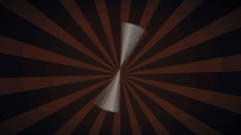</p>

```text
/plugin marketplace add hrmasss/animative
/plugin install animative@animative
```

Then ask: *"make me a 3 minute explainer about the history of the bicycle"*.

---

## What comes out

Real frames from a build. The source photo is public domain. Everything else is drawn by the
graphics kit at render time, so text is always sharp and spelled right.

| | | |
|:-:|:-:|:-:|
| 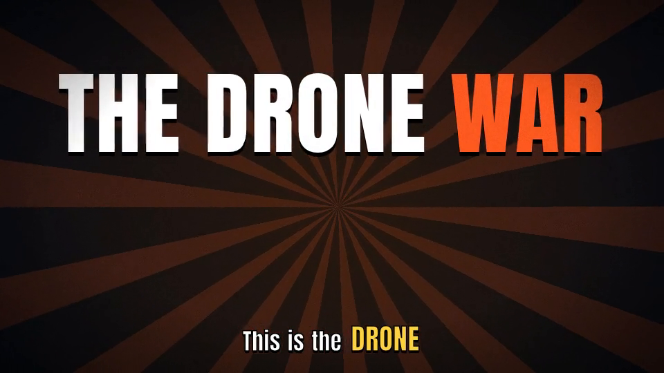 | 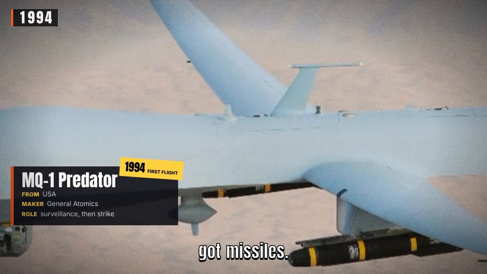 | 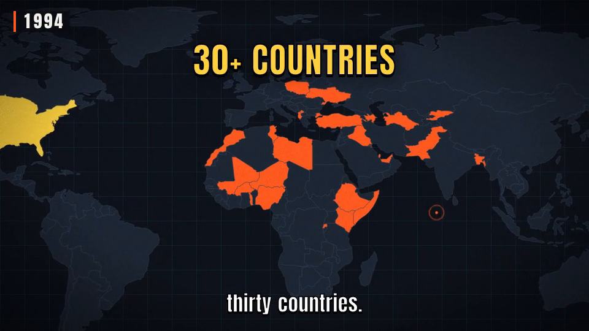 |
| **Title cards** | **Name cards** on sourced footage | **Maps** that light up the countries the voice names |
| 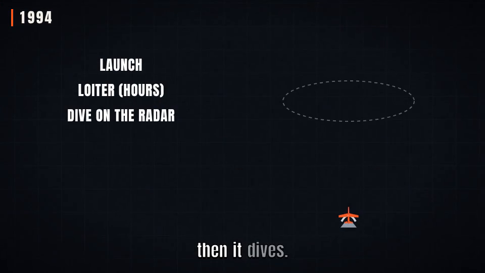 | 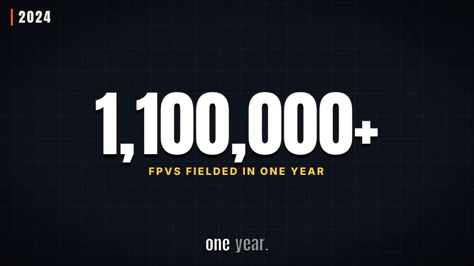 | 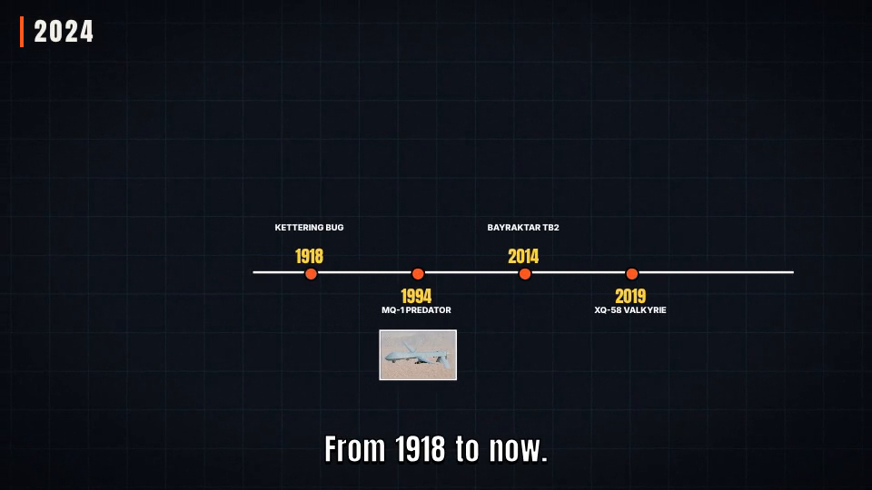 |
| **Diagrams**, animated step by step | **Counters** for the numbers that matter | **Timelines** to recap |

Kinetic captions run under everything, timed to the word. A year ticker in the corner keeps the
story's date.

## How a video gets made

You approve twice. Nothing is spent on generation, and nothing renders at full quality, before
each approval.

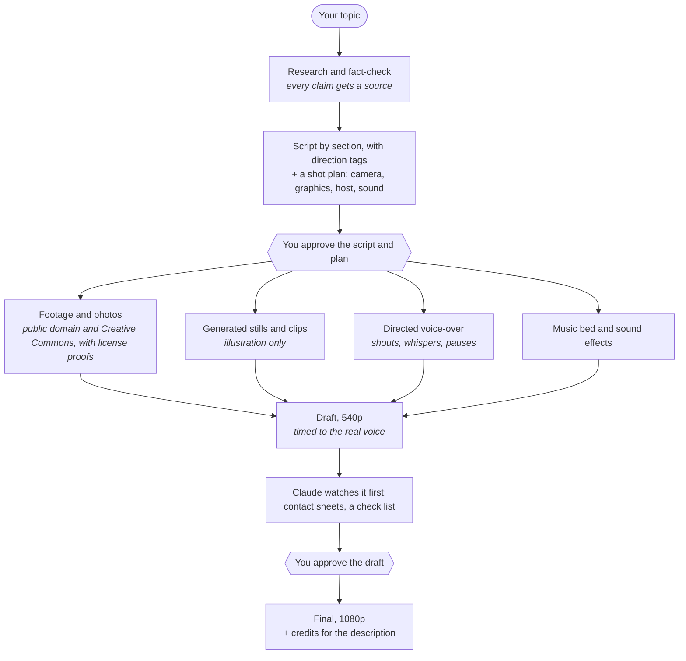

The script is written as *beats* (sections) with delivery tags the voice actually follows:

```markdown
[rising] Then came the hunters.
The MQ-1 Predator. American, built by General Atomics, first flown in 1994.
[shout] Hellfire! The first armed drone strikes, over Afghanistan.
And many of its crews? [beat] Sitting in a trailer in Nevada, half a world away.
```

## Your host

Any character works: you, a friend (with their OK), a mascot, an animal. You generate two kinds of
image with your usual tool, and the rest is mechanical.

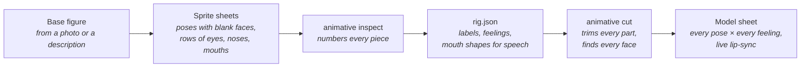

Faces are drawn blank on purpose. One set of eyes, noses and mouths then works on every pose, and
the cut finds each pose's face by itself:

<p align="center">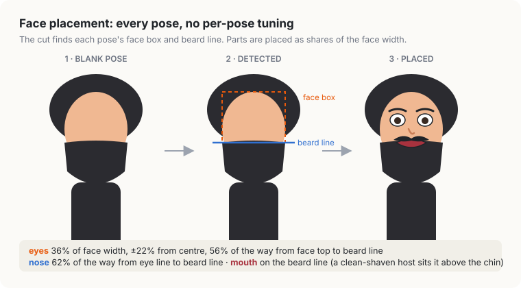</p>

A feeling is a recipe in the rig: which pose, which eyes (tilted a few degrees for sad or angry
brows), which mouth. Twelve feelings and ten mouth shapes cover a whole video. Single-frame poses
move with squash and stretch, so no in-between drawings are needed.

## Techniques

### Lip-sync from the real voice

<p align="center">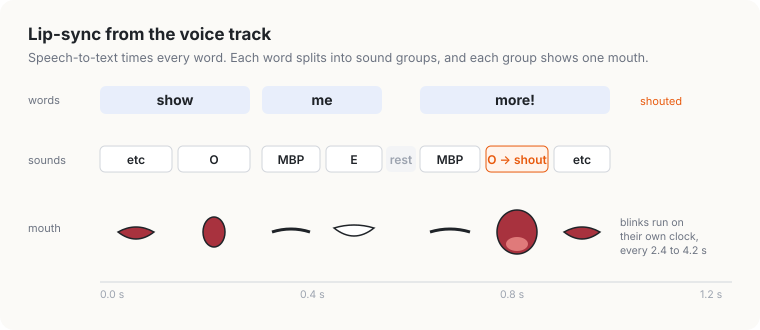</p>

The voice-over is transcribed with word timings, and the script is aligned to them. Each word
becomes the classic animation sound groups (MBP, AI, E, O, U, FV, L…). A shouted word swaps in the
wide shout mouth. Shots cut 0.12 s before a cue word, so a picture changes exactly when the voice
says what it shows.

### Nothing sits still

<p align="center">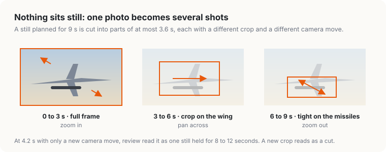</p>

Every still gets a camera move (zoom, pan, truck, a slight dutch tilt). No picture holds longer
than 3.6 s: a longer hold becomes several framings of the same source. The 3.6 s figure came
out of review.

### The mix

<p align="center">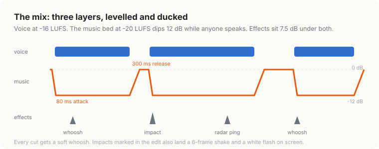</p>

Voice, music and effects are levelled to fixed loudness targets, then mixed sample by sample. The
music ducks under speech with a fast attack and a slow release, so it swells back between lines
instead of pumping.

### Honest by construction

- **Every claim has a source** in `facts.json`, checked before the script is shown to you.
- **Sourced media is public domain or Creative Commons**, with a license proof saved beside
  every file. `animative credits` writes the description credits.
- **Generated images are illustration, never evidence.** They never pose as footage of a real
  event, and never contain text.
- **No watermarks**, ever, not even on drafts.

## How it renders

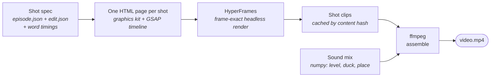

Every shot renders independently and is cached on the page, the kit and its media, so a fix
re-renders only the shots it touches. Timing is kept as rational frame numbers end to end; no
decimal frame rate ever appears. A 3-minute draft takes a few minutes on a 6-core CPU.

## Tools it can use

On first use Claude asks which of these you have, and remembers. It never assumes one.

| For | Options |
|---|---|
| Images | agy CLI, Codex CLI, ChatGPT or Gemini in your browser, or by hand |
| Video clips | Google Flow in your browser, by hand, or none (stills with camera moves) |
| Voice | Gemini TTS with an API key, Gemini TTS on Vertex AI, Google AI Studio in your browser, Kokoro, edge-tts, or by hand |
| Music | a bed generated offline, AI Studio, Lyria on Vertex, or a library track |
| Sound effects | CC0 effects from Freesound, or your own |

Browser options drive a tab you are already logged into, through Playwriter. By hand means Claude
writes the exact prompt and file name, and you drop the result in the project's inbox.

## Install

As a Claude Code plugin:

```text
/plugin marketplace add hrmasss/animative
/plugin install animative@animative
```

On first use, Claude installs the `animative` command with [uv](https://docs.astral.sh/uv/). It
then sets up a workspace, asks about your tools, and helps you make your host. You need Python
3.12+, uv, Node 22+ and ffmpeg. Docker is optional, for pinned, identical renders.

The engine also works on its own:

```bash
uv tool install git+https://github.com/hrmasss/animative
animative init && animative setup && animative doctor
```

It ships with *The Drone War* as a worked example: a 3:10 explainer with its script, a 38-shot
plan, a 16-claim fact-check and cleared sources (`animative new drones --from drone-war`). The
frames above are rebuilt by `docs/showcase/build.sh`.

## License

MIT. The bundled fonts (Anton, Inter) are under the SIL Open Font License 1.1.
